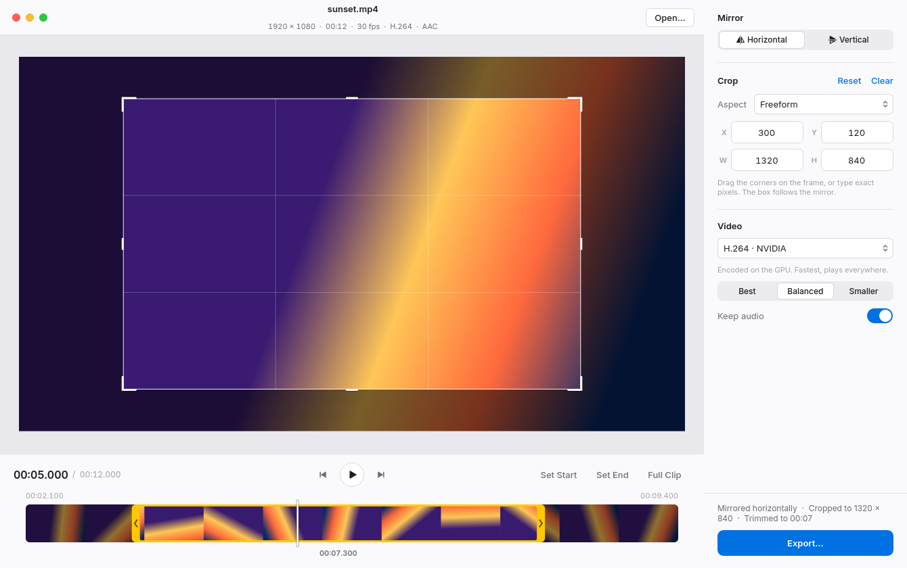

<div align="center">


# NanoSnip

**Mirror, trim, crop. Nothing else.**

A small, fast editor for photos and video on Linux.<br>
Native Qt 6, powered by ffmpeg. No timeline, no project files, no Electron.

<br>

<picture>
  <source media="(prefers-color-scheme: dark)" srcset="docs/screenshot-dark.png">
  
</picture>

</div>

<br>

## Why

Most of the time you don't need an editor. You need to flip a selfie, chop the
dead air off the start of a screen recording, or crop a clip to 9:16. NanoSnip
opens instantly, does those few things well, and gets out of the way.

- **Mirror** horizontally, vertically, or both.
- **Trim** by dragging the yellow handles on a real-thumbnail filmstrip.
- **Cut out the middle.** Split at the playhead and drop the pieces you don't want.
  The rest is joined back together, frame-accurately.
- **Snapping.** Handles, splits and the playhead snap to each other, so cuts line up.
- **Crop** freehand or to a fixed aspect (1:1, 16:9, 9:16, 4:3…), or type exact pixels.
- **Export** with NVIDIA NVENC when available, keeping audio by default.
- **Trim-only exports are lossless.** No re-encode, so they finish almost instantly.
- **Follows your system appearance**, light or dark.

## Install

### Arch / CachyOS

```sh
git clone https://github.com/devbnkdr/NanoSnip.git
cd NanoSnip
./install.sh
```

The installer pulls in `pyside6`, `qt6-multimedia-ffmpeg`, `ffmpeg` and
`inter-font` with pacman. It then installs NanoSnip for your user only:

- the app in `~/.local/share/nanosnip/`
- a `nanosnip` launcher in `~/.local/bin/`
- a desktop entry and icon, so it shows up in your app launcher

Run `./install.sh --uninstall` to remove it all again.

### Any other distro

Install **ffmpeg** from your package manager, then:

```sh
pipx install git+https://github.com/devbnkdr/NanoSnip.git
```

You can also run it straight from a checkout with `python3 nanosnip.py`, as long
as `PySide6` is importable.

## Use

```sh
nanosnip                      # empty window: drop a file in
nanosnip ~/Videos/clip.mp4    # open straight into a file
```

| To | Do this |
|---|---|
| Mirror | **Horizontal** / **Vertical** in the sidebar, or press `H` / `V` |
| Trim | Drag either yellow handle. Drag the middle to slide the selection. Double-click the strip to reset. |
| Cut | Press `S` (or **Split**) to split at the playhead. Hover a piece and click **×** to cut it out, or **+** to bring it back. Drag a split to move it, double-click it to remove it. |
| Snap | Handles, splits and the playhead snap to each other, to the clip's ends and to whole seconds. Hold `Shift` while dragging to move freely. |
| Crop | Drag the corners or edges on the frame, or type into **X / Y / W / H** |
| Export | **Export…**, or `Ctrl+E` |

### Keyboard

| Key | Action |
|---|---|
| `Space` | Play / pause |
| `←` `→` | Step one frame |
| `Shift` + `←` `→` | Jump one second |
| `I` / `O` | Set the trim start / end at the playhead |
| `S` | Split at the playhead |
| `Delete` / `Backspace` | Cut out the piece under the playhead, or bring it back |
| `Shift` (while dragging) | Turn snapping off |
| `H` / `V` | Mirror horizontally / vertically |
| `Ctrl+A` | Crop to the full frame |
| `Esc` | Remove the crop |
| `Ctrl+O` | Open |
| `Ctrl+E` | Export |

### Options

| Flag | Effect |
|---|---|
| `--light` / `--dark` | Force an appearance instead of following the system |
| `--native-frame` | Use your desktop's title bar instead of NanoSnip's own |
| `--version` | Print the version |

## How it behaves

- **The crop follows the mirror.** The filter chain is `hflip,vflip,crop`, so the
  box you draw on the mirrored preview is exactly what gets written.
- **Trim-only exports copy the streams** (`-c copy`). That's lossless and
  near-instant. MP4 and MOV files start exactly on the trim point; other
  containers start at the keyframe just before it.
- **Cuts are re-encoded.** Each kept piece is trimmed out and joined with
  ffmpeg's `concat` filter, so every cut lands on its exact frame. Playback in
  NanoSnip skips the cut pieces, so you hear and see the result before exporting.
- **Audio is kept** and only re-encoded (AAC 192k, or Opus for WebM) when the
  video is. Switch off *Keep audio* to drop it.
- **Crop sizes are rounded to even numbers**, because `yuv420p` requires it.
- **Photos never touch ffmpeg.** They're mirrored and cropped with Qt and saved
  in whatever format the file extension says.
- **If Qt can't play a codec** (this happens on some NVIDIA + Wayland setups),
  the preview switches to still frames taken with ffmpeg. Scrubbing, editing and
  export all still work; only in-app playback is lost.

## Window chrome

NanoSnip draws its own title bar. Drag the header to move the window,
double-click it to maximise, and drag any edge to resize. If your compositor
doesn't cooperate, run `nanosnip --native-frame`.

## Development

```sh
pip install pytest ruff
ruff check .
QT_QPA_PLATFORM=offscreen pytest

# regenerate the screenshots in docs/
QT_QPA_PLATFORM=offscreen python3 scripts/screenshots.py
```

NanoSnip is a single file, `nanosnip.py`, on purpose. Keep it that way.

### One-file binary

```sh
pip install --user pyinstaller
pyinstaller --onefile --windowed --name nanosnip nanosnip.py
```

The result in `dist/nanosnip` is about 80 MB because Qt is bundled, and it still
needs `ffmpeg` on the system.

## License

NanoSnip is free and open source under the [MIT License](LICENSE).
Copyright © 2026 devbnkdr.

You can use, copy, change and share it, including commercially, as long as the
copyright and license notice stay with it.

## Disclaimer

NanoSnip is provided **"as is", without warranty of any kind**, express or
implied, including the warranties of merchantability, fitness for a particular
purpose and non-infringement. In no event shall the author be liable for any
claim, damages or other liability arising from the software or its use. The
[license](LICENSE) has the full terms.

In plain words:

- **Keep backups.** NanoSnip never writes over the file you opened, and it
  always saves to a new file you choose. Still, it can overwrite *other* files
  if you tell it to, and video tools can fail in odd ways on odd files. Check an
  export before you delete the original.
- **You're responsible for what you edit.** Make sure you have the right to
  modify and share the media you work on.
- **Third-party software is under its own terms.** NanoSnip calls
  [FFmpeg](https://ffmpeg.org/legal.html) and uses
  [Qt / PySide6](https://www.qt.io/licensing/) (LGPL). It doesn't include
  either one; you install them yourself. A PyInstaller one-file build *does*
  bundle Qt, so if you share one, follow the LGPL terms. Some codecs, such as
  H.264 and HEVC, may be patent-encumbered where you live.
- NVIDIA and NVENC are trademarks of NVIDIA Corporation. NanoSnip isn't
  affiliated with or endorsed by NVIDIA, the FFmpeg project or The Qt Company.
